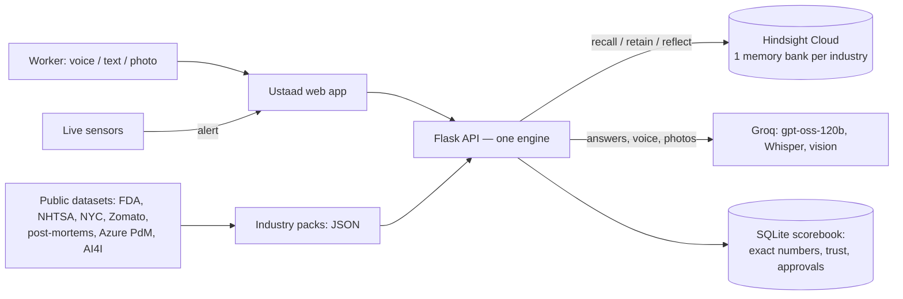

# Ustaad — the expert who never leaves

**When your best expert leaves, their know-how shouldn't.**

Every workplace has a Ramesh: the senior technician, head chef, biomedical engineer, mechanic or principal SRE who just *knows* what to check first. When they retire or quit, that knowledge walks out of the door. Manuals don't have it. Dashboards don't have it.

Ustaad is an AI agent with long-term memory (built on [Hindsight](https://github.com/vectorize-io/hindsight) by Vectorize) that:

1. **Captures** what experts actually do — by voice (Hindi, Kannada, English), text or photo.
2. **Recalls** the right fix at the right moment — who did it, when, and how often it worked.
3. **Learns** — every "✔ worked / ✖ didn't work" becomes a new memory, so good fixes rise and bad ones sink.

One engine, five industries: **Factory · Restaurant · Hospital operations · Car garage · IT on-call**. A new industry is one JSON file — no new code.

---

## Why memory is the whole product

| Without memory (generic chatbot) | With Ustaad's Hindsight memory |
|---|---|
| "Check spindle bearings, check lubrication, call the service engineer." | "On 21 Jul Ramesh fixed this: realign the coupling to under 0.02 mm. Two earlier attempts (bearing change, ₹38,000) did **not** work — don't repeat them. Pune plant's twin machine had the same fix." |

The app has a **Memory ON / OFF** switch so you can see this difference live.

### How Hindsight is used

| Hindsight call | Where in Ustaad |
|---|---|
| `create_bank` | One memory bank per industry (`ustaad-factory`, `ustaad-restaurant`, …) with retain/reflect missions written for that industry. |
| `retain` / `retain_batch` | Every work record, expert tip, exit-interview answer, "worked/didn't work" result and public record. Tagged with `asset`, `model`, `type`, `site`, `person`, `outcome`, `code`. |
| `recall` | Each question recalls memories for the same asset **or the same model at another site** (cross-site learning) or the same type, using tags with `tags_match="any"`. |
| `reflect` | Builds SOPs/playbooks: Hindsight reasons over all related memories ("what is the proven way, what failed before?"). |

If no Hindsight key is set, Ustaad falls back to a small built-in **practice memory** with the same interface, so the app always runs. The top bar shows which one is active.



---

## Features

**Core memory engine (every industry)**
- Ask Ustaad — answer with the expert's name, date, sources and how often it worked; cites memories as M1, M2…
- **Only relevant memories are used**: Hindsight finds memories by meaning, a second check re-ranks them by shared words and alarm codes, and the AI must say which memories are about the *same* problem. The trust banner counts only those; the rest fold under "Also searched".
- **Off-topic or unsafe questions** ("capital of France", a medicine dose) get a short "Outside what Ustaad answers" — no fake steps
- **🧠 Patterns Hindsight learned** — Hindsight's own observations (built from many memories) are shown as their own card type
- Memory ON/OFF toggle — generic chatbot vs memory-powered answer, side by side
- Answers with charts — "Which machine lost the most downtime hours?" returns a chart from exact records
- Trust levels on every memory: **Verified** (worked 2+ times / confirmed by 2 people) · **Tested once** · **Unreviewed** · **Didn't work** · **Public record**
- Source panel beside every answer, source badges (ISO 10816, FSSAI, WHO, FDA, NHTSA…)
- "Worked / Didn't work" feedback loop + guided mode (tick each step)
- Flag a wrong memory → Ustaad stops using it
- One-click translate (Hindi / Kannada / English) with **Sarvam Translate** (simple spoken-style words), answers in Hinglish too
- AI chain: **Groq** (gpt-oss-120b) writes the structured answer, **Sarvam-105B** takes over if Groq fails, then a rule-based answer — it never goes silent

**🏭 My machines (every industry: machines, kitchen equipment, hospital devices, vehicles)**
- Add a machine — and let Ustaad fill the form from the maker's **PDF manual**, its **product web page** or a **📷 nameplate photo**
- The manual's known faults, alarm codes and service tasks are saved into Hindsight as **📘 Maker's manual** memories
- Answers compare them: **"Manual says … / the team found …"**
- Machine page: 🚦 health light, 🔧 service due (last replacement picked up from the repair history), 📦 spare-parts stock, 🧾 warranty & vendor, full fix history, who knows it best, its manual
- **QR sticker** — print it, stick it on the machine; scanning opens Ask with that machine already chosen
- **Spare parts** — answers warn "Coupling spider: 0 in store, order now"; repair logs that replace a part take one off the stock; the shift report lists what is out
- **📡 Sensor auto-log** — when a sensor crosses its limit, Ustaad opens a half-filled log by itself; the technician only adds what they did. Normal readings after the fix mark it **Sensor-confirmed** (via `POST /api/i/<industry>/sensors/reading`)
- **📞 Ask the expert** — when a fix didn't work, Ustaad names who fixed this before and opens WhatsApp with the message ready

**Capture**
- Smart log: say it in any language, Ustaad auto-tags the asset, problem, cause, result
- Voice input with **Sarvam Saaras** (built for Indian languages and mixed speech; Groq Whisper as backup) · **🔊 Listen**: answers read aloud with **Sarvam Bulbul** · Photo input (read an alarm screen, nameplate, device display)
- **Worker mode**: workers see only Ask, "I fixed something" and Learn; everything else is for seniors and managers
- **"Not sure — search everything"**: workers don't have to pick the right machine; Ustaad also always searches the whole industry and marks results "found on another machine"
- Expert tips with sources · Detailed form
- Senior approval queue — new knowledge is "Unreviewed" until approved
- Role-based access — workers, seniors (can approve), managers

**For managers and experts**
- **ROI dashboard** (the manager's first screen, with a strip on the home page): downtime hours saved, repeat failures avoided, fixed vs failed rate, ₹ saved, monthly MTTR trend
- **Knowledge coverage map**: every machine scored out of 100 (proven fixes for its problems, written-down tips, how many people can fix it, manual added) with red flags like "Only Ramesh knows this machine"
- **Expert leaderboard**: points for fixes that worked and for fixes others reused (credit is linked to the memory that was used), with badges — Top fixer, Most reused, Sharpshooter, Mentor, Rising star

**People**
- Knowledge risk radar — "if Ramesh leaves, these fixes leave with him"
- Before-you-leave interview — questions only about what isn't written down; answers become tips
- Skill map · **Skill passport** with proof levels (Verified / Attested / Self-declared) and a shareable link — credit for experts, so they *want* to share
- Onboarding quiz generated from the team's own past problems
- Shift report built from real data (records, sensor alerts, repeat failures, pending approvals)

**Smart features**
- Live sensor replay → alert → "what fixed this last time?"
- Failure prediction model (gradient boosting, trained on Microsoft's public 100-machine dataset)
- Failure check calculator (rules from 10,000 public machining runs, AI4I 2020)
- Repeat-problem predictor ("returns every ~40 days, next due 8 Dec")
- Cross-site learning (Pune plant ↔ Bengaluru plant, Indiranagar ↔ Koramangala outlets, Bengaluru ↔ Mysuru hospital…)
- Impact & ₹ — time to fix, failed fixes and money, before vs after
- SOP / playbook export (print / save as PDF) · ₹ savings calculator

**Industry tools**
- 🏭 Factory: live sensors, failure prediction, failure check
- 🍛 Restaurant: Zomato complaint data (13.2 lakh reviews scanned), NYC kitchen inspection violations, dish facts
- 🏥 Hospital operations: WHO Surgical Safety Checklist + Neuro OT additions, FDA device reports, **no-diagnosis guard**
- 🚗 Car garage: OBD-II code meanings + team memory, NHTSA owner complaints
- 💻 IT on-call: 240 real public outage write-ups, real log patterns (Loghub)

**Build your own industry** — type "bakery" or "solar farm": Ustaad creates roles, equipment and starter questions with an empty memory, then learns from zero as people log work.

**Easy for a first-time user** — "▶ Try it in 30 seconds" on the home page, a "Start here" role, a grouped menu (Daily work / Team knowledge / For managers), a "What is this?" line on every screen, 3 first-visit hints, and a simple answer page (check first → steps → worked/didn't work; the reasons fold under "Show why").

**Demo guide** — a built-in walkthrough of 6 stories that touches every feature (story 6: a new machine arrives).

---

## Data — honest about what is real

People and companies in the demo are **fictional**. Facts and public data are **real**:

| Data | Used for |
|---|---|
| Team sensor CSV (3 machines) | Live sensor replay (stops before the file's physically impossible values) |
| Microsoft Azure Predictive Maintenance (Kaggle) | Failure-prediction model (8.76 lakh readings) |
| AI4I 2020 (UCI) | Failure check rules |
| Zomato Bangalore reviews (Kaggle) | Customer complaint counts per dish (no review text kept) |
| NYC restaurant inspections (NYC Open Data) | Most common kitchen violations |
| FDA MAUDE via openFDA | 276 real ventilator / infusion-pump malfunction reports |
| NHTSA complaints | 732 real owner complaints (VINs removed) |
| danluu/post-mortems, Loghub | 240 real outages, real log patterns |
| ISO 10816-1, FSSAI, WHO checklist, SAE J2012 | Facts inside expert tips |
| Your own maker manuals / product pages | "My machines" reads them when you add a machine (not stored in this repo) |

Spare-part stock numbers, install and warranty dates for the built-in machines are **demo data** (marked on screen). Last-replaced dates come from the repair history.

**About the model:** it scores AUC 1.0 on held-out months. That is because Microsoft generated this dataset for a tutorial and its failure signals are cleaner than any real plant — we checked for data leakage and found none. Expect lower accuracy on real data. The app says this on screen.

Raw datasets are **not** in this repo (size and licences). See [`data/README.md`](data/README.md) for sources and how to rebuild the small processed files.

---

## Run it locally

```bash
git clone https://github.com/<you>/ustaad.git && cd ustaad && python -m venv .venv && source .venv/bin/activate && pip install -r requirements.txt && cp .env.example .env && python app.py
```
Open http://localhost:5000. Without keys it runs on practice memory with rule-based answers. Add keys to `.env` for the full experience.

## Deploy on Render (manual settings)

1. Push this repo to GitHub. **Never commit `.env`.**
2. Render → New → **Web Service** → pick the repo, then set:
   - Language: **Python 3** · Instance: **Free**
   - Build command: `pip install -r requirements.txt`
   - Start command: `gunicorn app:app --workers 1 --threads 8 --timeout 120 --bind 0.0.0.0:$PORT`
   - Environment variables: `HINDSIGHT_API_KEY`, `GROQ_API_KEY`, `SARVAM_API_KEY` (optional: voice, translation, backup brain), `GITHUB_TOKEN` + `GITHUB_REPO` (optional: auto-save), `PYTHON_VERSION=3.12.7`
   - Health check path: `/health`
3. Load the memories into Hindsight once (about $0.81 of credit), locally with your `.env`:
   `python scripts/seed_hindsight.py --dry-run && python scripts/seed_hindsight.py`

## Tests

```bash
python tests/test_smoke.py
```
Covers every industry and every main endpoint, offline.

## For other AI agents (API)

Ustaad's memory can be used by other agents, not only people. Every screen is a plain JSON API, for example:

```bash
curl -s -X POST https://<your-app>.onrender.com/api/i/factory/ask -H "Content-Type: application/json" -d '{"asset_id":"CNC-3","problem":"alarm 2041 whistling at high rpm"}'
```
Main endpoints: `/api/industries`, `/api/i/<industry>/ask`, `/feedback`, `/smart-log`, `/memories`, `/playbook`, `/risk`, `/passport/<person>`, `/stats`, `/api/packs/custom`.

## Auto-save (data survives restarts and redeploys)

Everything people add on the live site — machines, work logs, tips, approvals, spare-part stock, flags, sensor states and custom industries — is saved a few seconds later to **one JSON file on a separate branch** (`ustaad-data`, file `ustaad-backup.json`) of your own repo, and loaded back when the server starts. Your code branch stays clean. The top bar shows **💾 Auto-save on**.

Set on the server (never in code): `GITHUB_TOKEN` — a fine-grained token for this one repo with **Contents: Read and write** — and `GITHUB_REPO` (e.g. `you/your-repo`). Safety: if the saved file can't be loaded at start, saving pauses (the chip says *paused*) so a network hiccup can never overwrite good data with an empty copy. Without these variables the app works exactly as before. If your repo is public, this file is public too — it holds demo data only, never keys.

## Sensor readings API

A factory's sensor gateway (or a PLC script) can post live readings:

```bash
curl -s -X POST https://<your-app>.onrender.com/api/i/factory/sensors/reading -H "Content-Type: application/json" -d '{"asset_id":"CNC-3","vib":2.1,"temp":41}'
```
A reading above the limit opens an auto-log. After a technician reports the fix as worked, three normal readings in a row mark it **Sensor-confirmed**. (The demo's sensor file stops at the fault, so on the demo it shows "waiting for normal readings".)

## Scaling

- **New customer** = a new Hindsight bank (`<prefix>-<industry>` → per company/site). No code change.
- **New industry** = one pack file in `data/packs/` (assets, people, roles, starter memories, panels).
- The API keeps no state between requests → run more copies. Move SQLite → Postgres for real customers; Hindsight handles the heavy memory/search work as a managed service.
- Privacy: India's DPDP Act — consent, anonymised records, hospital mode limited to equipment/process knowledge.
- **Where data lives:** knowledge (every log, result, tip, manual fact) → **Hindsight Cloud** (permanent). Exact lists and numbers (machines, stock, approvals, flags) → a local SQLite "scorebook" for speed, plus **auto-save** to your GitHub repo (below), because free hosting wipes the server's disk on every deploy. For real customers: Postgres.

## Next (not built yet)

Offline mode for low-network shop floors (saved SOPs + queued logs) · hands-free voice mode · onboarding quiz from a new machine's manual · twin-machine comparison across sites · WhatsApp bot · one memory bank per customer company.

## Project layout

```
app.py                  Flask API + static frontend
ustaad/                 engine: memory (Hindsight), agent, insights, store, packs, llm
data/packs/*.json       one file per industry
data/processed/*.json   small files built from public datasets
static/                 frontend (plain JS, built-in SVG charts, no build step)
scripts/                dataset processing, model training, pack building, Hindsight seeding
tests/                  smoke tests
```

Links: [Hindsight on GitHub](https://github.com/vectorize-io/hindsight) · [Hindsight docs](https://hindsight.vectorize.io/) · [What is agent memory](https://vectorize.io/what-is-agent-memory)
